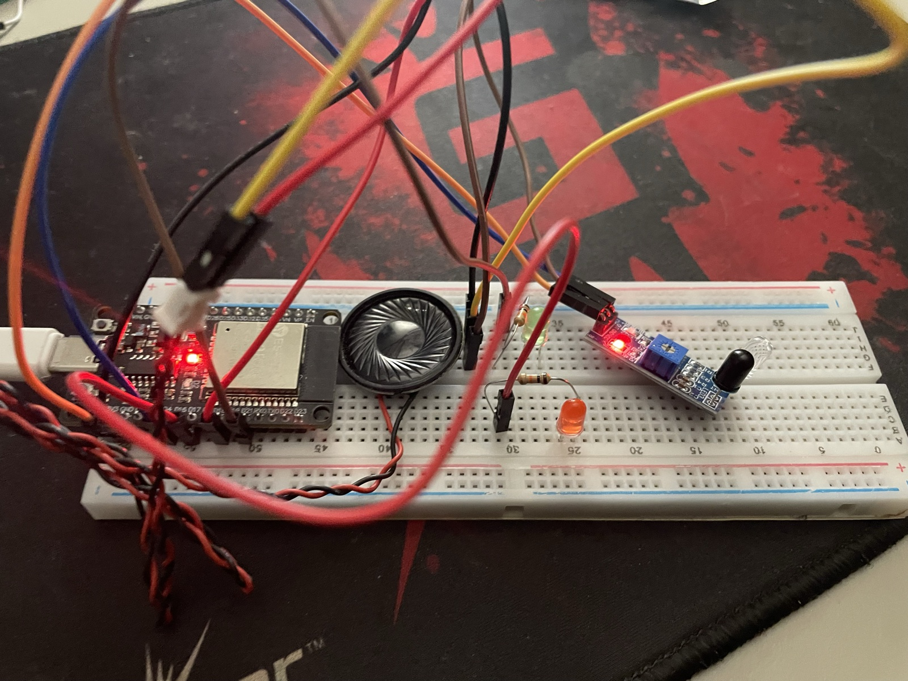
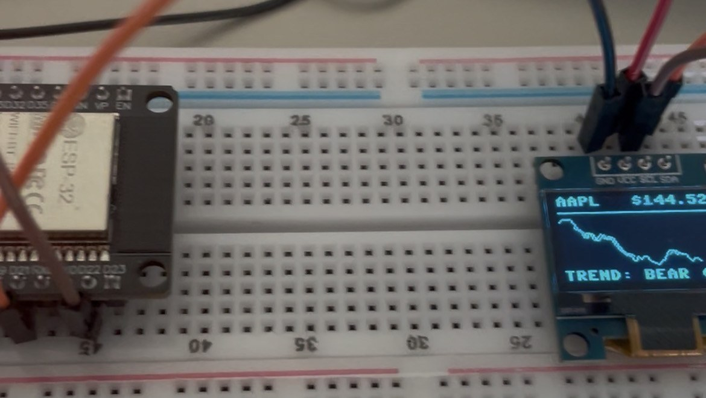

# ESP32 MicroPython Financial & IoT Experiments

A collection of MicroPython projects built for the ESP32, tracking the journey from fundamental hardware control (buttons, switches, buzzers) to interactive, API-driven financial monitoring tools. 

Incoming projects; Several ML projects driven by the ESP32S3 using CNNs, and other image classifers. Later; running other limited AI/ML models. Finance applications for ML. Blockchain technology in python + nfc tag with electronics to complete 1 entire transaction with my own cryptocurrency.

## Project Overview

| Script File | Description | Hardware Components |
| :--- | :--- | :--- |
| `boot.py` | Runs on every boot. Left empty except for commented-out debug hooks. | ESP32 |
| `input_light_program.py` | Basic digital input handling and LED state toggle. | Push button, LED, Resistors |
| `switch_light_program.py` | State-change logic using physical switches. | Toggle switch, LED |
| `deck_halls_buzzer.py` | Tone generation and frequency mapping for audio playback. | Passive buzzer |
| `motion_sensor_audio.py` | Distance/motion detection triggering audio cues. | Motion/Proximity sensor, Buzzer |
| `oled_simple_display.py` | Initial screen buffer rendering and text placement. | I2C OLED Display |
| `oled_stock_demo.py` | Static financial data rendering loop layout. | I2C OLED Display |
| `bitcoin_fetch_motion_sensor_buzzer.py` | Interactive live crypto ticker that evaluates market direction (bullish/bearish) via motion trigger, playing dynamic audio cues and rendering data to screen. | ESP32, Motion Sensor, Passive Buzzer, OLED Display, Wi-Fi |

## Setup

Wi-Fi credentials are not stored in this repo. On the ESP32, copy `secrets.py.example` to `secrets.py` and set `WIFI_SSID` and `WIFI_PASS`.
